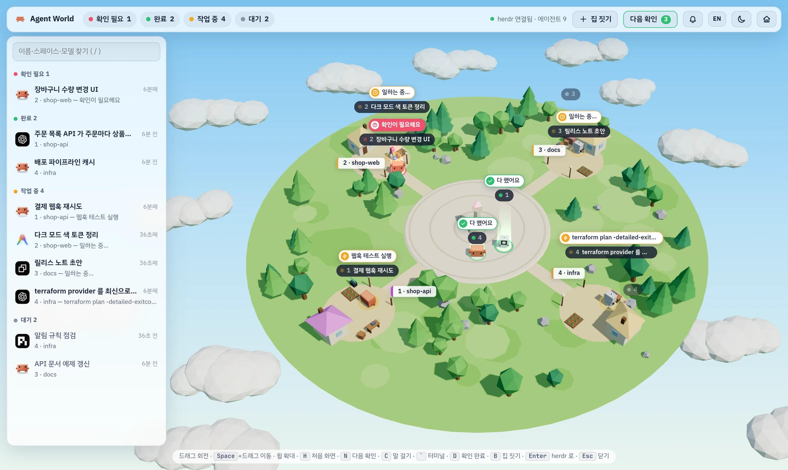
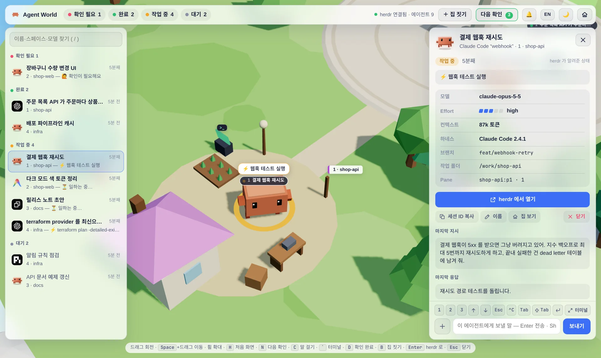
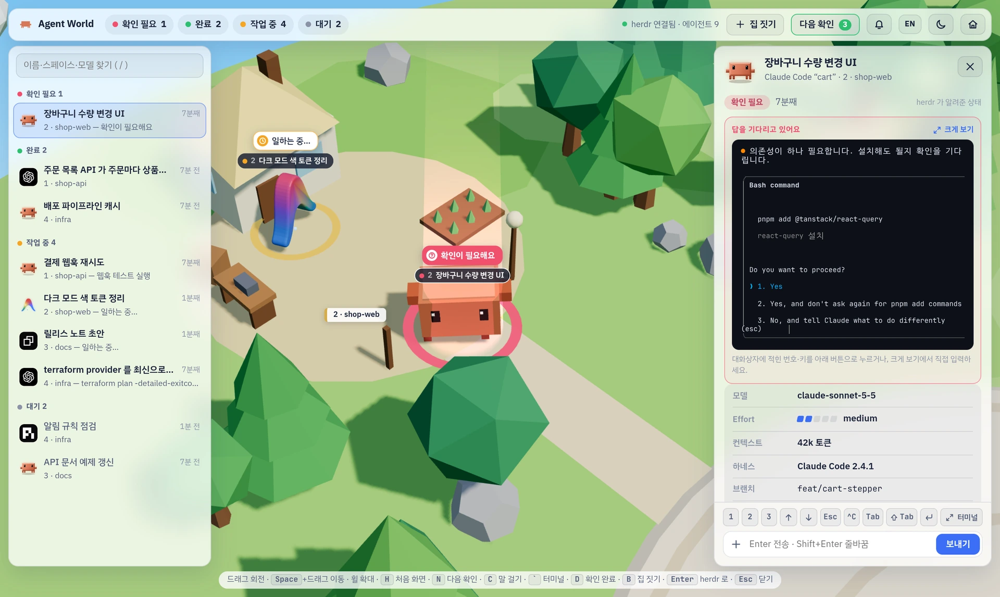
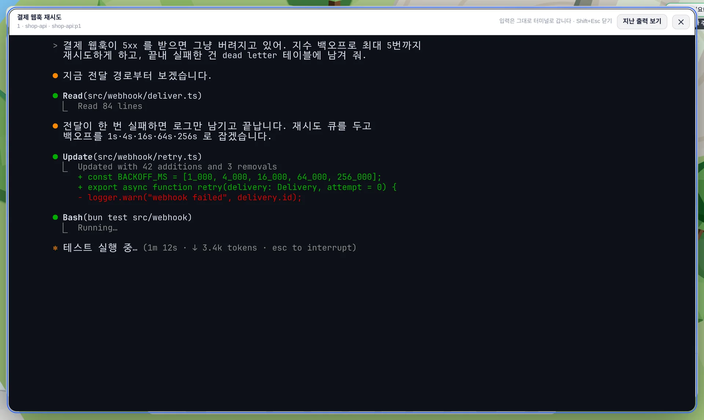
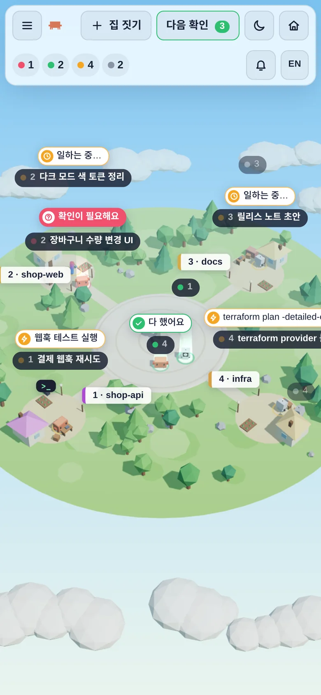
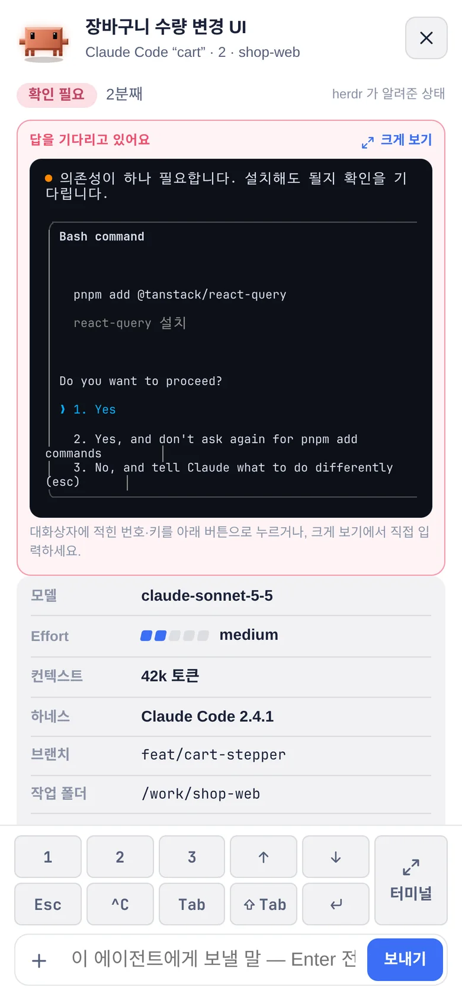
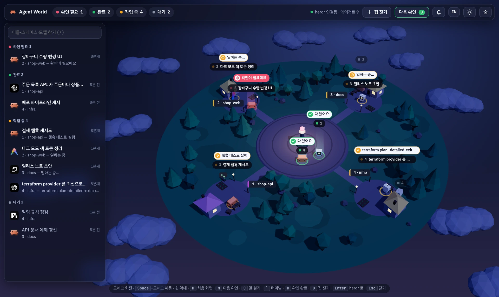

# Agent World

[한국어](README.md) · [Homepage](https://agent-world.ksyoon.com/)

A local dashboard that shows the coding agents running in [herdr](https://herdr.dev) as a 3D village, and lets you
talk to them and build new workspaces without going back to the herdr window. One agent is one character, and
**where it stands is its status**.



| Status | Where the character is |
| --- | --- |
| Working | In the yard of its workspace's house. The speech bubble shows what it is doing. |
| Done | Walks out to the plaza in the middle and waits (green beam). |
| Needs input | Comes out to the gate of its house and jumps (red beam). |
| Idle | Dozes beside the house (dimmed). |

Click a character to open its status window: model, effort, context, last prompt and reply, activity log and the
terminal screen. `Copy` next to the last prompt and the last reply takes the original text (Markdown as written). The activity log shows one-line summaries; tap a line to expand that activity in full (the whole reply, the exact command it ran). The camera frames the house that character lives in (the plaza for one that is done) and stays put when you pick a housemate; closing the window (✕ or Esc) returns to where you were. On a wide screen the character's terminal runs in the space between the roster and the status window: click it to open the full terminal, or fold it with ✕ to read it inside the status window instead.
`Open in herdr` (Enter) switches herdr to that pane and, on Hyprland, brings the terminal window to the front.



The screenshots come from a test session that imitates a made-up project (`dev/mock-herdr.ts`), shown in the default Korean UI.

The UI is Korean by default. Switch to English with the `EN` button in the top bar (remembered per browser), by
opening `?lang=en`, or by setting `AGENT_WORLD_LANG=en`.

## What you can do in the world

| To | Do this |
| --- | --- |
| Send a prompt | The input at the bottom of the status window (`C`). Enter sends, Shift+Enter adds a line. Delivery is confirmed from the user turn that appears in the agent's log. |
| Show an image | Paste it into the input, drop it, or pick it with `＋` (PNG, JPEG, GIF, WebP; 10MB each, 8 at a time). It goes with the prompt. |
| Use a skill or command | In a Claude Code session, type `/` at the start of the input. Typing filters by name and description; pick with ↑↓ and Enter (or Tab) and `/name ` goes to the front of the input — it is not sent, so add the task after it. The list is the session's own skill list from its log plus what SKILL.md front matter says: skills users cannot invoke (`user-invocable: false`) are left out and slash-only ones (`disable-model-invocation: true`) are added. A few built-in model-only skills (`keybindings-help` and others) have no file to check; picking one gets a refusal from Claude. Of the built-in commands, only the ones that are safe to send from here — `/clear`, `/compact`, `/context` — are listed, at the top. Commands that open a dialog (`/usage`) or change the default for other sessions (`/model`) are not listed but can still be typed and sent.<br><br>Antigravity sessions get the same picker. Antigravity keeps no skill list in its log, so the list is read from disk: the project's `.agents/skills`, your `~/.gemini/config/skills`, and the skills of enabled plugins (`plugin:name`), leaving out `disable-slash-command: true`. Skills bundled with Antigravity are not listed but can be typed and sent. The commands at the top are `/clear`, `/compact`, `/rename` and the prompt commands `/plan`, `/goal`, `/grill-me`, `/teamwork`, `/boost`, `/browser`, `/schedule`, `/learn`. Commands that open a panel which swallows the next prompt (`/context`, `/usage`, `/codesearch`), `/btw` (its answer only shows in the terminal), and commands that change saved settings (`/model`, `/effort`) are left out. Antigravity does not log slash commands, and logs a prompt sent mid-turn only after that turn ends, so delivery is confirmed from its input history (`history.jsonl`). After `/clear` the session shows empty until the next prompt. |
| Stop what it is doing | `Stop` at the right end of the status line while it works. It is the same as Esc in the terminal: the current turn ends and any text in its input stays (Claude Code, Codex, Antigravity). Claude Code goes straight on to a prompt you queued while it worked, so that turn is stopped as well, and so are any background agents. Because you stopped it, it does not walk to the plaza or notify you; it counts as seen. Not shown while it waits on a question, where Esc would decline it. |
| Answer a question or permission request | When an agent needs input, the real dialog appears at the top of the status window. Press the number or key it shows with the quick-key row. |
| Use the terminal directly | `` ` `` opens it large. While it is open, keystrokes go straight to the pane. `Scrollback` shows earlier output; for agents with no scrollback (Claude Code in fullscreen mode) it scrolls the app itself: Claude Code gets mouse-wheel signals for as far as you wheel or drag past the edge, so it follows line by line, and other agents get PageUp/PageDown a page at a time. Closing returns it to the live screen. Shift+Esc closes it. |
| Switch model or effort | `Switch…` at the end of the model row, for Claude Code and Codex sessions. It applies to that session only; sessions you start later keep the harness defaults (the slash commands would change those too, so the world uses Claude Code's "this session only" picker option and Codex's `/model … --reasoning=…`). Not while the agent is working, waiting on a question, or has unsent text in its input. Antigravity has no session-only switch, so its model is picked at start. |
| See plans and usage | The top bar shows a logo and a percentage per harness — the most-used of its limit windows (5h, 7d …), orange from 70% and red from 90%. Click it for the plan name and, per window, how much is used, how much is left and when it resets. When the bar is narrow only the most-used harness stays. Nothing is fetched: these are the values each harness left on this machine, so usage from other devices shows up the next time that harness runs here, and a harness you have not used for a while is dimmed with the time of its reading. |
| Mark a result as seen | A finished agent waits in the plaza until you press `Mark as seen` (`D`) in its status window, or send it a new prompt; then it walks home. Opening the window and moving on leaves it there. Undo from the toast. |
| Widen the status window | Drag its left edge. The width is remembered; double-click to reset. |
| Build a house | `＋ New house` (`B`) — folder, name, worktree or not, the agent to add with its model and effort, and its first prompt, in one go. The model and effort go in as launch flags (`--model`, `-m` …), so they apply to that session only. |
| Add residents and tabs | Click a house sign for the house panel — `New resident`, `New tab`, rename, demolish. Shell panes stand in front of the house as small terminals. |
| Work on several branches of one repository | Worktrees of the same repository share one lot: the main checkout is the main house and each worktree workspace is a smaller annex beside it. `Add worktree` in the house panel builds a new annex on a new branch without picking the folder again; the panel also lists the other houses of that repository. |
| Close things | Closing a pane, tab or house lists the agents that will stop with it and asks first. |





On a narrow screen such as a phone, the list becomes a drawer opened with `☰`, and the status window and terminal
use the whole screen. On touch devices the terminal shows a row of keys the on-screen keyboard lacks (Esc, Tab,
arrows, Ctrl+C …) and an input line that shows what you type. Ctrl and Alt on that row stick to the next key: tap Alt,
then Enter, and Alt+Enter goes out; tap Alt and type m for Alt+M. Held upright, a phone wraps the terminal's lines
at the screen's width instead of keeping its columns. Boxes that only read with their columns intact, such as tables,
are not wrapped but scaled down to fit, and scroll sideways if they are still too wide.

<p>
  
  
</p>

You can **install it to the home screen** as an app: `Add to Home screen` (or `Install app`) in Android Chrome's menu,
or Share → `Add to Home Screen` in iOS Safari. It then opens full-screen without the address bar. On iOS a home-screen
app has storage separate from Safari, so paste the keyed address once after installing. When the server comes back
with a new version, open pages reload themselves (they wait while you are typing or have something open).

Turn on the bell button at the top to be **notified** when an agent finishes or needs input — also while the page is closed or
the app is in the background (Web Push). It is off by default, switched on per device, and one more tap turns it off.
Notifications for the same agent replace each other, and in Chromium browsers you only get the page's toast while you are looking at it.
While you are using one of the devices with notifications on (its window is in front and was touched in the last 5 minutes, or on
desktop Chrome the keyboard or mouse was used in any app in the last 2 minutes), notifications go to that device only — your
phone and watch stay quiet while you sit at the PC. When you then walk away, whatever went only to the PC in the meantime and
is still unchanged is sent to the phone as well. To have it notice you in other apps, allow the idle detection permission
Chrome asks for on your first click in the page.
On iOS it is available only in the installed home-screen app (16.4 or later). The text is encrypted so that only your
browser can read it; the push service in between (Google, Apple, Mozilla) cannot. While nobody has the page open the
server looks at the agents only every 15 seconds, so a notification can be that late.

Worth knowing:

- **"Seen" is Agent World's own record.** herdr only counts a result as seen when its screen moves to that pane, and
  Agent World does not touch herdr's focus. So herdr's sidebar keeps its done mark (pressing `Open in herdr` clears
  both). The record lives in `~/.local/state/agent-world/seen.json` (`seen-<socket hash>.json` for a named herdr
  session) and is dropped automatically when the agent works again.
- **Questions are not turned into buttons.** Choices differ by harness and version, so the screen is shown as it is
  and keys are sent as they are.
- Terminal colours come from your ghostty config — background, foreground and palette, including `theme = …`
  (a dark default otherwise).
  The fonts follow the ghostty config too: `font-family`, `font-family-bold`, the weight in `font-variation-bold` and
  `font-codepoint-map` are read, and the font files are found on this machine and served (Linux with fontconfig), so a
  phone shows the same typeface as your terminal. Restart the server after changing fonts.
- **Attached images become files on this machine.** They are written to `~/.cache/agent-world/images/` and the path
  is typed into the pane. Claude Code turns the path into `[Image #N]`; other harnesses get the path in the prompt
  text. Files older than seven days are removed.
- **Question cards count as needs input.** While a desk-look or desk-plan question or plan card waits for an answer,
  herdr still reports the agent as working; Agent World reads the marker file the card leaves and shows it as needs
  input (desk-look 0.81.5 or later). A plan card also gets a `Read plan` button on its status-window card and in the
  header of the large terminal: the terminal shows the plan clipped in a side pane, so the button fetches the plan
  file and shows it as formatted text (headings, tables, code). Keys pressed in that view do not reach the
  terminal; it follows the file as the agent revises it and closes once the plan is answered. The status-window card
  and the plan view also have `Approve and start`, so you can approve without opening the terminal. It is sent only
  while the card is still up, so pressing it after you already answered in the terminal does not type `1` into the
  input. You can also ask for changes there: type them in the box under the plan and press `Ask for changes`
  (Ctrl+Enter). It goes to the card as the same answer as its text field, so the agent stays in plan mode, revises the
  plan, and asks again. `Line comments` shows the source with line numbers; click a number (and another for a range)
  to comment on those lines, and each comment is sent with its line numbers and the quoted lines. What you typed
  stays while that card is up, even if you close the view, and is not sent if you already answered in the terminal.
  After sending, Agent World checks the session log that Claude actually got the text. If the card closed but the
  text did not arrive (for example, desk-plan did not understand the answer), a notice says so and what you wrote,
  line comments included, waits for the next plan card.
- **Review reports from desk-review.** When [desk-review](https://github.com/KyongSik-Yoon/cc-desktop-mod/tree/main/desk-review)'s
  `/desk-review:simplify-review` finishes, the status window gets `Read review` (`R`). The report is drawn in a side
  pane next to the terminal, which is hard to see on a phone, so the button reads the same report from the session log
  and shows it on its own: open findings first, then what the review fixed, skipped cleanups, cleanups applied,
  dismissed findings, what was not verified and what to decide next. Each item has its file, line and reason, and how
  it was fixed or why it was left. Pick open findings and skipped cleanups, add a note if you like, and `Fix` sends
  them to the agent; all open findings start picked. The card stays through follow-up questions; once you send fixes it
  shrinks to `Open review` and stays until the next review, also across a restart of Agent World.
- **Another PWA on the same host's default port can take the notifications.** Seen on Android Chrome: with another
  app installed from the same tailnet address on port 443, notifications appeared under that app's name. Moving that
  app to another port, removing it from the phone and turning the bell on again fixed it.
- Left to the herdr TUI: pane layout, size and movement, copy mode, mouse, plugins, remote machines, session management.



## Use it as a herdr plugin

```sh
herdr plugin install KyongSik-Yoon/agent-world
```

It needs [Bun](https://bun.sh) (checked on 1.4.4). Once installed, herdr starts the server whenever herdr starts
(and leaves it alone if one is already running for that session). The server stops by itself a minute after its herdr
session ends. It adds four actions.

| Action | id | What it does |
| --- | --- | --- |
| `Agent World: open in browser` | `open` | Starts it if needed and opens it in the browser, handing over the access key. |
| `Agent World: show address` | `info` | Shows the keyed address in a popup — for the first visit from another browser such as a phone (`o` open · `r` restart · `s` stop). |
| `Agent World: restart` | `restart` | Stops and starts it again — after an update or a config change. |
| `Agent World: stop` | `stop` | Stops the server for this herdr session. |

herdr has no command palette that lists plugin actions. Bind the ones you use in `~/.config/herdr/config.toml`, then
run `herdr server reload-config`. These two keys don't clash with herdr's defaults:

```toml
[[keys.command]]
key = "prefix+shift+o"
type = "plugin_action"
command = "kyongsik-yoon.agent-world.open"
description = "Agent World: open in browser"

[[keys.command]]
key = "prefix+i"
type = "plugin_action"
command = "kyongsik-yoon.agent-world.info"
description = "Agent World: show address"
```

Run an unbound action from inside a herdr pane with `herdr plugin action invoke restart --plugin kyongsik-yoon.agent-world`.

The server attaches to that herdr session. The default session is at `http://127.0.0.1:4780`; a named session gets
its own fixed port (see `AGENT_WORLD_PORT` below). To configure it, put the environment variables below as
`NAME=value` lines in the `env` file of the folder printed by `herdr plugin config-dir kyongsik-yoon.agent-world`,
then `restart`:

```sh
AGENT_WORLD_LANG=en
AGENT_WORLD_READONLY=1
```

Logs are in `herdr plugin log list --plugin kyongsik-yoon.agent-world` and in `server.log` in the plugin's state folder.

## Run it yourself

```sh
bun install
bun start            # Agent World → http://127.0.0.1:4780/#k=<key>
```

The printed address carries an **access key**. Open that address once in each browser; after that the browser
remembers it and plain `http://127.0.0.1:4780` works. `bun run url` prints the address again.

| Environment variable | Meaning |
| --- | --- |
| `AGENT_WORLD_PORT` | Port. Without it, each herdr session uses a fixed one — 4780 for the default session, and for a named session one port in 4781–4879 derived from its socket path (the same session always gets the same port). If that port is taken it moves to the next one, and if a server is already running for the same herdr it just prints that address and exits. `bun run url` prints the current address. Bound to loopback only. |
| `AGENT_WORLD_LANG` | Default language: `en` for English, Korean otherwise. Each browser can switch with the `EN`/`한` button in the top bar (remembered) or by opening `?lang=en`. |
| `AGENT_WORLD_READONLY=1` | Read-only. Refuses prompts, keystrokes, creating, closing and `Open in herdr` (moving herdr's screen). Viewing still needs the key. |
| `AGENT_WORLD_TRUST_HOSTS` | The address(es) used when serving through `tailscale serve` (`host.tailnet.ts.net:4780`, comma-separated). Only requests from the account that put this machine on the tailnet are accepted. |
| `AGENT_WORLD_OUTSIDE=1` | Also show sessions outside herdr (other terminals, desktop apps) while attached to herdr. |
| `AGENT_WORLD_RAISE=0` | Do not bring the terminal window to the front on `Open in herdr`. |
| `HERDR_SOCKET_PATH` | herdr socket path (default `~/.config/herdr/herdr.sock`). |
| `AGENT_WORLD_DEV=1` | For working on the UI: rebuilds the bundle on every change (`bun run dev`). |

Camera: drag to rotate, `Space`+drag (or middle/right-button drag) to pan, wheel to zoom. `⌂` (`H`) resets position,
zoom and angle.

Shortcuts: `N` next agent to check · `C` talk · `` ` `` terminal · `D` mark as seen · `R` read review · `B` build a house · `Enter` open
in herdr · `/` search · `H` home · `T` day/night · `Esc` close. Shortcuts are off while you type in an input or the terminal.

This server shows your terminal screens and can type into your terminals. So:

- It binds to 127.0.0.1 only and requires an **access key** on every `/api` request. The key is created on first
  start and kept in a file only you can read (`~/.local/state/agent-world/key`), so other accounts on the same
  machine, or a program that merely knows the address, can neither read screens nor type. To rotate the key, delete
  that file and restart (each browser then needs the new address once).
- Changes are accepted only as same-origin POSTs and only target panes, tabs and workspaces that exist in herdr now.
- The page is served with a Content-Security-Policy, a second barrier against agent-written text running as script.

Treat the keyed address like a password — do not paste it where others can see it.

To use it from another device, expose it inside your tailnet only (never to the public internet):

```sh
AGENT_WORLD_TRUST_HOSTS=<host>.<tailnet>.ts.net:4780 bun start
tailscale serve --bg --https=4780 http://127.0.0.1:4780
```

At start the server also prints the tailnet address with the key — open that once on the other device. A request
from the tailnet must carry the key and come from the account that put this machine on the tailnet. Use
`tailscale serve` in HTTPS mode only: requests arriving through `tailscale funnel` (public internet) are refused, and
raw `--tcp` forwarding should not be used because the sender cannot be identified.

## How it knows

It does not hook into the harnesses or touch settings such as the status line. It reads the herdr socket and the files the harnesses leave on this machine; the only thing it asks the network for is Claude Code usage (see usage below).

- **The herdr socket** — `session.snapshot` tells it which pane runs which agent, its status and its session id.
  Control goes through the same socket (`agent.prompt`, `pane.send_input`, `workspace.create`, `agent.start` …).
- **The logs the harnesses write themselves** — it finds the file by session id, reads only the tail, and takes the
  model, effort and current activity from it. It does not keep the full text of activities: tapping a line in the
  activity log reads just that one line again.

| Harness | Log |
| --- | --- |
| Claude Code | `~/.claude/projects/*/<session>.jsonl` |
| Antigravity | `~/.gemini/antigravity-cli/brain/<session>/.system_generated/logs/transcript_full.jsonl` |
| Codex | `~/.codex/sessions/YYYY/MM/DD/rollout-*-<session>.jsonl` |

Claude Code's log has the tokens used but not the size of the context window. If the herdr web UI's status-line
capture is installed, the window size it leaves per session (`~/.herdr/statusline-context/`) is read so the status
window shows a percentage and a bar; without it, only the token count is shown.

Usage is read from what is already there, except Claude Code, whose usage API is asked directly. File times are checked
every 30 seconds and only a changed file is read again; account emails, ids and tokens are never sent to the page.

| Harness | Plan and usage from |
| --- | --- |
| Claude Code | Every 3 minutes, `https://api.anthropic.com/api/oauth/usage` is asked with the sign-in token Claude Code left (`~/.claude/.credentials.json`, else the macOS Keychain or Linux Secret Service): 5h, 7d and per-model weekly limits such as Fable. The token is only read, never refreshed — once it expires the last values stay until Claude Code gets a new one. A 429 pauses it for 10 minutes. Start with `AGENT_WORLD_CLAUDE_USAGE_API=0` to turn it off. If the herdr web UI's status-line capture (`~/.herdr/statusline-last.json`) or a status-line script that leaves the usage API response (`$XDG_RUNTIME_DIR/claude-statusline/statusline-usage-cache.json`) is there, those are mixed in for fresher values. The plan name comes from the account in `~/.claude.json`. |
| Codex | `rate_limits` on the `token_count` rows of the session log (windows and plan), from the most recently used session. |
| Antigravity | `/tmp/agy-statusline-<uid>/last-payload.json`, only if your status-line script leaves what it receives there. Antigravity does not write this file itself, so without such a script it does not appear. |

While attached to herdr it shows herdr's agents only, because sessions outside herdr (other terminals, desktop
apps) cannot be talked to or marked as seen from here. When herdr is not running it finds sessions from logs that
moved in the last 30 minutes and estimates their status from log times (`AGENT_WORLD_OUTSIDE=1` shows them even
while herdr is running). Other harnesses get a character from the title and status herdr reports — add an adapter
under `server/adapters/` to read their logs.

## Layout

```
server/   Bun server — herdr RPC, log tailing, snapshots pushed over SSE
  control.ts  control endpoints (prompts, keys, terminal mirror, create, close)
  models.ts   model lists per harness, launch flags, session-only model switches
  usage.ts    plan and limit usage per harness, from the files the harnesses leave
  adapters/   log readers per harness
  text.ts     server messages in both languages
  key.ts      the access key and owner-only state files
  push.ts     notifications while the page is closed (Web Push)
web/      three.js scene and HUD
  detail.ts   status window (agent, shell, house), term.ts terminal mirror, build.ts create/close dialogs
  usage.ts    the usage button in the top bar and its window
  world/      island and plots (environment), characters, actors, layout, label layer (labels)
  app/        manifest and icons for installing to the home screen, the service worker that receives notifications (sw.js)
  i18n.ts     t() and the language switch; locale/en.ts holds the English strings
shared/   snapshot types used by both sides
scripts/  plugin.ts — start/stop/open when run as a herdr plugin
dev/      mock-herdr.ts — a fake herdr socket for testing the UI; i18n-check.ts; perf/ — UI performance lint and frame check;
          reap-orphan-bun.sh — on session start, stops bun processes that ended Claude Code sessions left in this repo
docs/     the homepage (index.html) and screenshots
```

`bun run probe` prints the current snapshot as a table without starting the server. `bun run url` prints the address
(with the key) of the server running for this herdr session. `bun run i18n` checks that every UI string has an English entry.
`bun run perf:lint` and `bun run perf` check UI performance: the lint looks for things like endless CSS animations in the
code, and the frame check runs the mock session in a GPU headless Chrome and verifies the page never presents more frames
than the scene draws (`--compare` measures cost against an earlier version). Changes to web/ reach main only after the
frame check passes.

To try the usage button with made-up values, point `AGENT_WORLD_CLAUDE_LIMITS` at a Claude Code limits file (and
`AGENT_WORLD_CLAUDE_USAGE` at a usage API response for per-model limits),
`AGENT_WORLD_AGY_PAYLOAD` at an Antigravity payload (Claude Code's shows only when the account matches
`CLAUDE_CONFIG_DIR/.claude.json`; either Claude Code variable also stops it asking the usage API). A server started with `CLAUDE_CONFIG_DIR`, `CODEX_HOME` and `AGY_HOME` pointing at
empty folders reads none of this machine's real usage.

To test control features, use a named test session instead of the herdr you are working in:

```sh
env -u HERDR_SOCKET_PATH -u HERDR_CLIENT_SOCKET_PATH -u HERDR_SESSION -u HERDR_ENV herdr --session aw-test server &
HERDR_SOCKET_PATH=~/.config/herdr/sessions/aw-test/herdr.sock AGENT_WORLD_PORT=4782 bun start
herdr session stop aw-test && herdr session delete aw-test
```

The brand marks for Codex, pi, opencode, oh-my-pi, Grok and Muse, and the tile colours, come from Collie's (MIT) icon data. Clawd and the Antigravity arch — both the characters and the animated logos in the list — are drawn for this project. See [THIRD_PARTY_NOTICES.md](THIRD_PARTY_NOTICES.md).

## License

[MIT](LICENSE)
