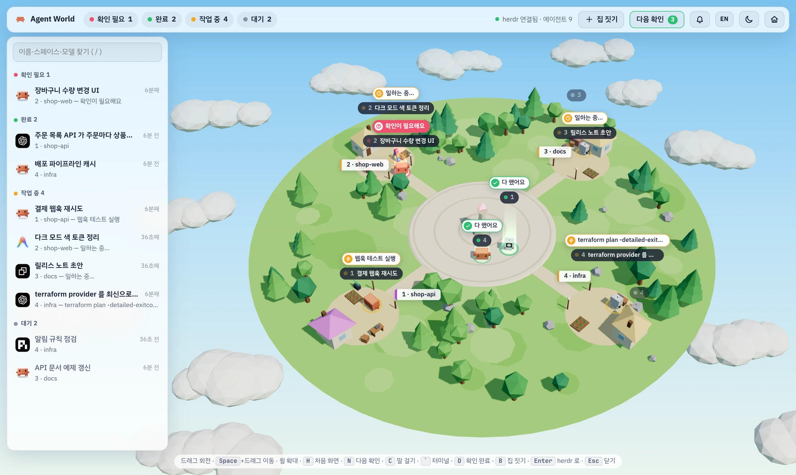
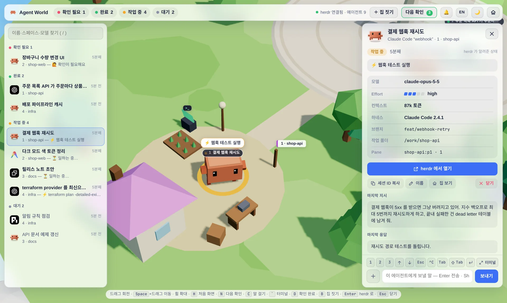
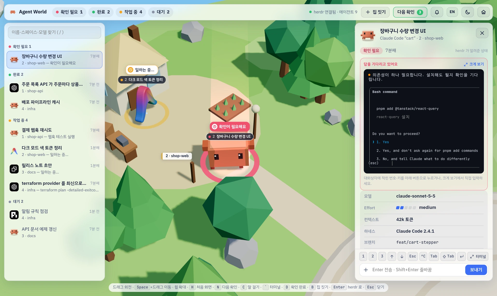
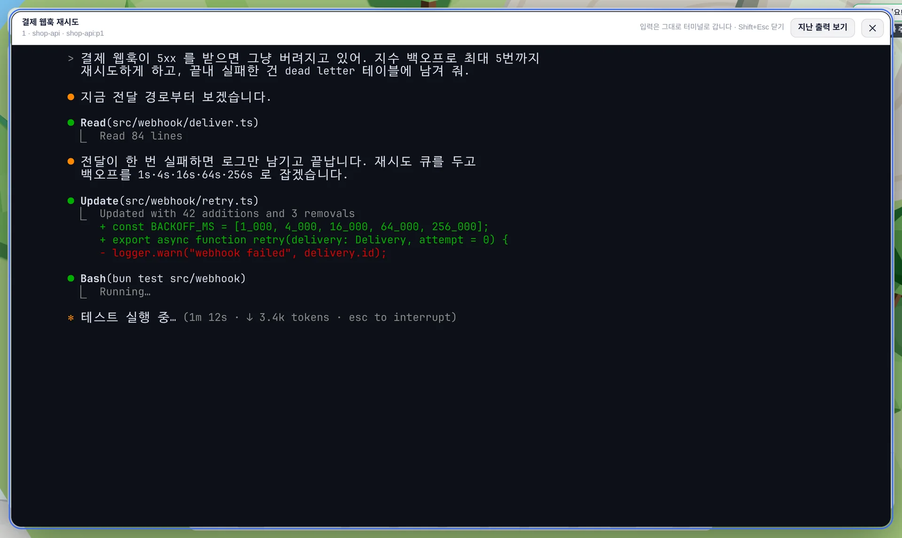
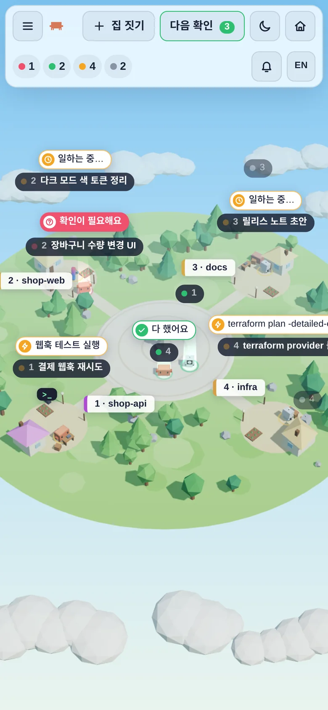
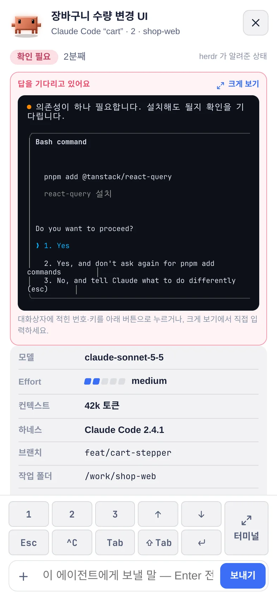
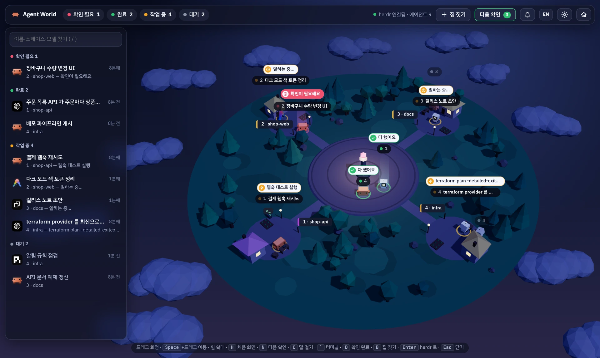

# Agent World: 코딩 에이전트들이 사는 3D 마을

[English](README.en.md) · **한국어** · [홈페이지](https://agent-world.ksyoon.com/)

herdr 에 띄워 둔 코딩 에이전트를 3D 마을로 보여 주는 로컬 대시보드입니다. 에이전트 하나가 캐릭터 하나이고, 캐릭터가 서 있는 곳을 보면 상태를 알 수 있습니다. herdr 창으로 돌아가지 않고 여기서 바로 지시를 보내고, 질문에 답하고, 새 워크스페이스(집)를 만듭니다.



```sh
herdr plugin install KyongSik-Yoon/agent-world
```

[Bun](https://bun.sh)만 깔려 있으면 설치는 이것으로 끝입니다(1.4.4 에서 확인했습니다). herdr 명령 팔레트에서 `Agent World: open in browser` 를 고르면 브라우저로 열립니다.

스크린샷은 실제 세션이 아니라 가상의 프로젝트를 흉내 낸 시험용 세션(`dev/mock-herdr.ts`)에서 찍었습니다.

## 무엇을 할 수 있나

### 서 있는 곳이 상태

- 작업 중: 자기 워크스페이스 집터 마당에서 일합니다. 말풍선에 지금 하는 일이 뜹니다
- 완료: 가운데 광장으로 걸어 나와 기다립니다(초록 빛기둥)
- 확인 필요: 집터 대문 앞에 나와 뜁니다(빨간 빛기둥)
- 대기: 집 옆에서 졸고 있습니다(흐리게 보입니다)

탭을 하나씩 넘겨 볼 필요 없이, 광장에 누가 나와 있고 대문 앞에서 누가 뛰는지만 보면 됩니다. `N` 을 누르면 확인할 캐릭터로 차례로 이동합니다.

### 캐릭터를 누르면 상태 창



모델, effort, 컨텍스트, 마지막 지시와 응답, 활동 로그, 터미널 화면이 한 창에 나옵니다. 카메라가 그 캐릭터 쪽으로 다가가고, 창을 닫으면(✕ 또는 Esc) 보던 자리와 배율로 돌아옵니다. 창이 좁으면 왼쪽 가장자리를 끌어 넓히면 됩니다. 맞춘 폭은 브라우저가 기억하고, 두 번 누르면 처음 폭으로 돌아갑니다. 마지막 지시와 마지막 응답은 제목 옆의 `복사`로 원문(마크다운 그대로)을 가져갈 수 있습니다. 활동 로그는 한 줄 요약이라 길면 잘리는데, 줄을 누르면 그 활동의 원문(응답 전문, 실제로 돌린 명령)이 펼쳐집니다.

아래 입력창(`C`)에 지시를 쓰고 Enter 로 보냅니다. 줄바꿈은 Shift+Enter 입니다. 보냈다고 바로 "전달됨"이라 하지 않고, 에이전트의 로그에 사용자 턴이 찍힌 것을 확인한 뒤에 알려 줍니다. 이미지는 입력창에 붙여 넣거나 끌어다 놓거나 `＋` 로 고르면 지시와 함께 갑니다(PNG·JPEG·GIF·WebP, 장당 10MB, 한 번에 8장).

모델 줄 끝의 `바꾸기…`로 Claude Code·Codex 세션의 모델과 effort 를 바꿉니다. 바꾼 값은 그 세션에만 적용되고 다음에 띄우는 세션의 기본값은 그대로입니다. 슬래시 명령으로 바꾸면 기본값까지 바뀌기 때문에, Claude Code 는 `/model` 선택 창에서 "이 세션만"을 고르고 Codex 는 `/model … --reasoning=…` 을 보냅니다. 일하는 중이거나 질문에 막혀 있을 때, 입력창에 쓰던 글이 있을 때는 바꾸지 않습니다. Antigravity 는 그 세션에만 바꾸는 길이 없어 띄울 때만 고릅니다.

`herdr 에서 열기`(Enter)를 누르면 herdr 화면이 그 pane 으로 넘어갑니다. Hyprland 에서는 터미널 창도 앞으로 나옵니다.

### 질문에는 그 자리에서 답하기



에이전트가 권한을 묻거나 질문을 하면 상태 창 위쪽에 그 대화상자가 그대로 뜹니다. 거기 적힌 번호나 키를 빠른 키 줄에서 누르면 됩니다. 선택지를 버튼으로 바꿔 보여 주지는 않는데요, 하네스와 버전마다 선택지가 달라서 화면을 그대로 보여 주고 키도 그대로 보냅니다.

플랜 승인을 기다리는 카드에는 `플랜 읽기`가 붙습니다(desk-plan). 터미널에서는 플랜이 옆 창에 잘려 보이는데, 이 단추는 플랜 파일을 받아 제목·표·코드를 갖춘 글로 따로 띄웁니다. 읽기만 하는 창이라 그 안에서 누른 키는 터미널로 가지 않고, 에이전트가 플랜을 고쳐 쓰면 따라 바뀌며 승인하면 닫힙니다. 크게 연 터미널의 머리줄에도 같은 단추가 있습니다.

### 터미널이 필요하면



`` ` `` 를 누르면 그 pane 의 화면이 크게 열립니다. 열려 있는 동안에는 키 입력이 그대로 pane 으로 가고 한글도 됩니다. `지난 출력 보기`로 스크롤백을 보고, Shift+Esc 로 닫습니다. 전체 화면으로 도는 Claude Code 처럼 스크롤백이 남지 않는 에이전트는 PageUp/PageDown 을 보내 앱의 화면을 넘깁니다(화면 끝에서 더 끌거나 굴려도 넘어가고, 창을 닫으면 지금 화면으로 돌아갑니다). 색은 ghostty 설정에서 읽은 배경·글자색·팔레트를 씁니다(설정이 없으면 어두운 기본색입니다). 글꼴도 ghostty 설정을 따릅니다. `font-family`·`font-family-bold`·`font-variation-bold` 의 굵기·`font-codepoint-map` 을 읽어 그 글꼴 파일을 이 PC 에서 찾아 내주므로(fontconfig 가 있는 Linux), 휴대폰에서도 터미널과 같은 글씨로 보입니다. 글꼴을 바꿨으면 서버를 다시 띄웁니다.

### 완료 확인

일을 끝낸 캐릭터는 상태 창의 `확인 완료` 단추(`D`)를 누를 때까지 광장에서 기다립니다. 상태 창을 열어 보기만 하고 다른 곳으로 옮겨도 그대로 남고, 단추를 누르거나 새 지시를 보내면 집으로 돌아갑니다. 잘못 눌렀으면 토스트에서 되돌립니다.

### 요금제와 사용량

위쪽 막대에 하네스마다 로고와 퍼센트가 하나씩 뜹니다. 한도 창(5시간, 7일 등) 가운데 가장 많이 쓴 창의 값이고, 70% 부터 주황, 90% 부터 빨강이 됩니다. 누르면 요금제 이름과 창마다 쓴 만큼·남은 만큼·초기화까지 남은 시간이 나옵니다. 막대가 좁으면 가장 많이 쓴 하네스 하나만 남습니다.

어디에 물어보는 값이 아니라 각 하네스가 이 PC 에 남긴 값입니다. 그래서 다른 기기에서 쓴 만큼은 그 하네스를 여기서 다시 쓸 때 반영되고, 한동안 쓰지 않은 하네스는 흐리게 보이며 언제 값인지 함께 적힙니다. 남긴 것이 없는 하네스는 뜨지 않습니다.

### 집 짓기

`＋ 집 짓기`(`B`)에서 폴더, 이름, 워크트리 여부, 들일 에이전트와 그 모델·effort, 첫 지시까지 한 번에 정합니다. 모델과 effort 는 실행 인자(`--model`, `-m` 등)로 넘겨 그 세션에만 적용됩니다. 지어 둔 집의 문패를 누르면 집 패널이 열리고, 여기서 `새 주민`, `새 탭`, 이름 바꾸기, 철거를 합니다. 셸 pane 은 집 앞에 단말기 모양으로 서 있습니다.

pane·탭·집을 닫을 때는 함께 꺼지는 에이전트를 먼저 보여 주고 확인을 받습니다.

### 휴대폰에서도

<p>
  
  
</p>

좁은 화면에서는 목록이 `☰` 로 여닫는 서랍이 되고, 상태 창과 터미널은 화면 전체를 씁니다. 터치 기기의 터미널에는 화면 자판에 없는 키(Esc·Tab·화살표·Ctrl+C 등)가 버튼 줄로 나오고, 입력 중인 글자가 보이는 입력란이 아래에 붙습니다. 버튼 줄의 Ctrl·Alt 는 걸어 두는 키라서, Alt 를 누르고 Enter 를 누르면 Alt+Enter, Alt 를 누르고 m(한글 자판이면 ㅡ)을 치면 Alt+M 이 갑니다. 휴대폰을 세워 들면 터미널은 칸에 맞추지 않고 화면 폭에서 줄을 접어 보여 줍니다. 표처럼 칸이 맞아야 읽히는 상자는 접지 않고 폭에 맞춰 줄이고, 그래도 넓으면 옆으로 밀어 봅니다.

홈 화면에 앱으로 설치할 수도 있습니다. Android Chrome 은 메뉴의 `홈 화면에 추가`(또는 `앱 설치`), iOS Safari 는 공유 → `홈 화면에 추가`입니다. 주소창 없이 전체 화면으로 뜹니다. iOS 는 홈 화면 앱의 저장소가 Safari 와 따로라서, 설치하고 처음 한 번은 열쇠가 붙은 주소를 붙여 넣어야 합니다.

위쪽의 종 단추를 켜면 에이전트가 끝났거나 확인을 기다릴 때 알림이 옵니다. 화면을 닫았거나 앱을 내려 둔 동안에도 옵니다(Web Push). 기본은 꺼져 있고, 기기마다 따로 켜며, 다시 누르면 꺼집니다. 같은 에이전트의 알림은 한 장으로 갈아 끼우고, Chrome 계열에서는 화면을 보고 있는 동안 화면의 토스트로만 알립니다. iOS 는 홈 화면에 설치한 앱에서만 켤 수 있습니다(16.4 이상). 알림의 글은 그 브라우저만 풀 수 있게 잠가서 보내므로 중간의 푸시 서버(Google·Apple·Mozilla)는 내용을 읽지 못합니다. 아무도 화면을 보고 있지 않으면 서버가 15초에 한 번만 상태를 살피므로 알림도 그만큼 늦을 수 있습니다.

서버가 새 버전으로 다시 뜨면 열려 있던 화면은 알아서 새로 읽습니다. 무언가 쓰고 있거나 열어 둔 동안에는 기다려 줍니다.

### 낮과 밤



처음에는 기기의 라이트/다크를 따라갑니다. 기기가 시간에 맞춰 바꾸면 같이 바뀝니다. `T` 를 누를 때마다 기기를 따름 → 낮 → 밤 차례로 바뀝니다.

## 조작과 단축키

드래그로 돌리고, `Space`+드래그(또는 휠 버튼·오른쪽 버튼 드래그)로 맵을 옮기고, 휠로 확대·축소합니다. `⌂`(`H`)를 누르면 위치·배율·각도가 처음 화면으로 돌아갑니다.

- `N`: 다음 확인 대상
- `C`: 말 걸기
- `` ` ``: 터미널
- `D`: 확인 완료
- `B`: 집 짓기
- `Enter`: herdr 로 이동
- `/`: 찾기
- `H`: 처음 화면
- `T`: 낮/밤
- `Esc`: 닫기

입력란이나 터미널에 글을 치는 동안에는 단축키가 동작하지 않습니다.

## herdr 플러그인으로 쓰기

설치하면 herdr 가 시작할 때마다 서버를 띄워 둡니다(같은 세션에 이미 떠 있으면 그대로 둡니다). herdr 세션이 끝나고 1분이 지나면 서버도 스스로 꺼집니다. 명령 팔레트에는 동작 네 가지가 생깁니다.

- `Agent World: open in browser`: 서버가 떠 있지 않으면 띄우고 브라우저로 엽니다. 접속 열쇠도 함께 넘깁니다
- `Agent World: show address`: 열쇠가 붙은 주소를 팝업으로 보여 줍니다. 휴대폰 같은 다른 브라우저에서 처음 열 때 씁니다(`o` 열기 · `r` 다시 띄우기 · `s` 끄기)
- `Agent World: restart`: 껐다가 다시 띄웁니다. 업데이트했거나 설정을 바꾼 뒤에 씁니다
- `Agent World: stop`: 이 herdr 세션의 서버를 끕니다

서버는 그 herdr 세션에 붙습니다. 기본 세션은 `http://127.0.0.1:4780` 이고, 이름 붙은 세션은 세션마다 다른 포트를 씁니다(아래 `AGENT_WORLD_PORT`).

설정은 `herdr plugin config-dir kyongsik-yoon.agent-world` 가 알려 주는 폴더의 `env` 파일에 환경 변수를 `이름=값` 으로 적고 `restart` 하면 됩니다.

```sh
AGENT_WORLD_LANG=en
AGENT_WORLD_READONLY=1
```

서버 로그는 `herdr plugin log list --plugin kyongsik-yoon.agent-world` 와 플러그인 상태 폴더의 `server.log` 에 있습니다.

## 직접 실행

```sh
bun install
bun start            # Agent World → http://127.0.0.1:4780/#k=<열쇠>
```

출력된 주소에는 접속 열쇠가 붙어 있습니다. 브라우저마다 처음 한 번은 이 주소로 열어야 하고, 그다음부터는 브라우저가 기억해서 `http://127.0.0.1:4780` 만으로 열립니다. 주소를 다시 보고 싶으면 `bun run url` 을 실행합니다.

## 환경 변수

- `AGENT_WORLD_PORT`: 포트입니다. 주지 않으면 herdr 세션마다 정해진 포트를 씁니다. 기본 세션은 4780, 이름 붙은 세션은 소켓 경로로 정해지는 4781~4879 중 하나입니다(같은 세션이면 늘 같은 포트). 그 포트를 누가 쓰고 있으면 옆 포트로 옮겨 띄우고, 같은 herdr 에 서버가 이미 떠 있으면 그 주소만 알려 주고 끝납니다. 지금 주소는 `bun run url` 로 봅니다. 루프백에만 묶입니다
- `AGENT_WORLD_LANG`: 기본 언어입니다. `en` 이면 영어, 그 밖에는 한국어입니다. 화면 오른쪽 위의 `EN`/`한` 버튼으로 브라우저마다 따로 바꿀 수 있고(기억됩니다), 주소에 `?lang=en` 을 붙여 열어도 됩니다
- `AGENT_WORLD_READONLY=1`: 보기 전용입니다. 지시·키 입력·만들기·닫기와 `herdr 에서 열기`(herdr 화면 옮기기) 요청을 모두 거절합니다. 보기만 할 때도 열쇠는 필요합니다
- `AGENT_WORLD_TRUST_HOSTS`: `tailscale serve` 로 내보낼 때의 주소입니다(`host.tailnet.ts.net:4780`, 쉼표로 여러 개). 이 PC 를 tailnet 에 올린 계정의 요청만 받습니다
- `AGENT_WORLD_OUTSIDE=1`: herdr 에 붙어 있는 동안에도 herdr 밖의 세션(다른 터미널, 데스크톱 앱)을 함께 보여 줍니다
- `AGENT_WORLD_RAISE=0`: `herdr 에서 열기`를 눌러도 터미널 창을 앞으로 가져오지 않습니다
- `HERDR_SOCKET_PATH`: herdr 소켓 경로입니다(기본 `~/.config/herdr/herdr.sock`)
- `AGENT_WORLD_DEV=1`: 화면 코드를 고칠 때 씁니다. 번들을 매번 새로 만듭니다(`bun run dev`)

## 다른 기기에서 쓰기

tailnet 안으로만 내보냅니다. 공인 인터넷에는 공개하지 않습니다.

```sh
AGENT_WORLD_TRUST_HOSTS=<host>.<tailnet>.ts.net:4780 bun start
tailscale serve --bg --https=4780 http://127.0.0.1:4780
```

서버가 뜰 때 tailnet 주소도 열쇠와 함께 출력되니, 다른 기기에서는 그 주소로 한 번 열면 됩니다. tailnet 으로 들어온 요청은 열쇠가 맞아야 하고, 이 PC 를 tailnet 에 올린 계정이 보낸 것이어야 받습니다.

`tailscale serve` 의 HTTPS 방식만 쓰세요. `tailscale funnel`(공인 인터넷 공개)로 들어온 요청은 거절합니다. `--tcp` 로 그대로 넘기는 방식은 누가 보냈는지 알 수 없어서 쓰지 않습니다.

## 보안

이 서버는 터미널 화면을 내보내고 터미널에 글자를 넣을 수 있습니다. 남이 붙으면 곤란하니 이렇게 막아 두었습니다.

- 127.0.0.1 에만 묶이고, 모든 `/api` 요청에 접속 열쇠를 요구합니다. 열쇠는 서버가 처음 뜰 때 만들어 이 사용자만 읽을 수 있는 파일(`~/.local/state/agent-world/key`)에 둡니다. 같은 PC 의 다른 계정이나, 주소만 아는 다른 프로그램은 화면을 읽지도 글자를 넣지도 못합니다
- 무언가를 바꾸는 요청은 같은 출처에서 온 POST 만 받습니다. 대상도 지금 herdr 에 실제로 있는 pane·탭·스페이스로 한정합니다
- 화면 문서에 콘텐츠 보안 정책을 붙여, 에이전트가 쓴 글이 스크립트로 실행될 길을 한 겹 더 막았습니다

열쇠가 붙은 주소는 비밀번호처럼 다뤄 주세요. 남에게 보이는 곳에 붙여 넣으면 안 됩니다. 열쇠를 바꾸고 싶으면 위의 파일을 지우고 서버를 다시 띄웁니다(브라우저마다 새 주소로 한 번씩 다시 열어야 합니다).

## 알아 둘 것

- 확인 처리는 월드에만 남는 기록입니다. herdr 는 화면이 그 pane 으로 넘어갔을 때만 "봤다"고 치는데, 월드는 herdr 의 초점을 건드리지 않거든요. 그래서 herdr 사이드바에는 완료 표시가 그대로 남습니다(`herdr 에서 열기`를 누르면 같이 풀립니다). 기록은 `~/.local/state/agent-world/seen.json` 에 있고(이름 붙은 herdr 세션은 `seen-<소켓 해시>.json` 으로 따로 둡니다), 에이전트가 다시 일하기 시작하면 저절로 무효가 됩니다
- 붙인 이미지는 이 PC 의 파일로 저장됩니다. `~/.cache/agent-world/images/` 에 쓰고 그 경로를 pane 에 넣습니다. Claude Code 는 경로를 받아 `[Image #N]` 으로 붙이고, 그 밖의 하네스에는 경로를 지시문에 넣어 보냅니다. 7일이 지난 파일은 지웁니다
- desk-look·desk-plan 의 질문 카드나 플랜 카드가 답을 기다리는 동안에도 확인 필요로 올립니다. herdr 는 이때를 작업 중으로 보는데, 카드가 남기는 표식 파일을 읽어 바로잡습니다(desk-look 0.81.5 이상)
- 같은 tailnet 주소의 기본 포트(443)에 다른 PWA 를 설치해 두었다면 알림이 그 앱 이름으로 뜰 수 있습니다. Android Chrome 에서 겪은 일인데요, 그 앱을 다른 포트로 옮기고 휴대폰에서 지운 뒤 종 단추를 다시 켜니 풀렸습니다
- pane 배치·크기·이동, 복사 모드, 마우스, 플러그인, 원격 머신, 세션 관리는 herdr TUI 에 남겨 두었습니다

## 동작 원리

하네스에 훅을 걸지 않습니다. 읽는 것은 herdr 소켓과 하네스가 이 PC 에 남긴 파일뿐입니다.

먼저 herdr 소켓입니다. `session.snapshot` 으로 어느 pane 에 어떤 에이전트가 있는지, 상태가 무엇인지, 세션 id 가 무엇인지 읽습니다. 조작도 같은 소켓으로 보냅니다(`agent.prompt`, `pane.send_input`, `workspace.create`, `agent.start` …).

다른 하나는 하네스가 직접 남기는 로그입니다. 세션 id 로 파일을 찾아 끝부분만 읽고, 모델·effort·지금 하는 일을 뽑아냅니다. 활동의 원문은 들고 있지 않고, 활동 로그의 줄을 누를 때 그 한 줄만 다시 읽습니다.

- Claude Code: `~/.claude/projects/*/<session>.jsonl`
- Antigravity: `~/.gemini/antigravity-cli/brain/<session>/.system_generated/logs/transcript_full.jsonl`
- Codex: `~/.codex/sessions/YYYY/MM/DD/rollout-*-<session>.jsonl`

Claude Code 의 로그에는 쓴 토큰만 있고 컨텍스트 창 크기는 없습니다. herdr 웹 UI 의 statusLine 기록을 켜 두었으면 그것이 세션마다 남기는 창 크기(`~/.herdr/statusline-context/`)를 읽어 상태 창에 비율과 막대를 함께 보여 주고, 없으면 토큰 수만 보여 줍니다.

사용량도 남아 있는 것만 읽습니다. 30초에 한 번 파일 시각을 보고 바뀐 것만 다시 읽으며, 계정 메일이나 id 는 화면으로 보내지 않습니다.

- Claude Code: herdr 웹 UI 의 statusLine 기록이 남기는 `~/.herdr/statusline-last.json`(5시간·7일 창). 요금제 이름은 `~/.claude.json` 의 계정 정보에서 읽고, 두 파일의 계정이 같을 때만 보여 줍니다
- Codex: 세션 로그의 `token_count` 행에 실려 오는 `rate_limits`(창과 요금제). 가장 최근에 쓴 세션의 것을 씁니다
- Antigravity: statusLine 스크립트가 받은 값을 `/tmp/agy-statusline-<uid>/last-payload.json` 에 남겨 둘 때만 읽습니다. Antigravity 가 스스로 남기는 파일이 아니라서, 그런 스크립트를 쓰지 않으면 뜨지 않습니다

그 밖의 하네스는 herdr 가 알려 주는 제목과 상태만으로 캐릭터가 섭니다. 로그까지 읽게 하려면 `server/adapters/` 에 어댑터를 하나 추가하면 됩니다.

herdr 에 붙어 있는 동안에는 herdr 의 에이전트만 보여 줍니다. herdr 밖의 세션(다른 터미널, 데스크톱 앱)에는 월드에서 말을 걸 수도, 확인 처리를 할 수도 없어서입니다. herdr 가 꺼져 있을 때는 최근 30분 안에 움직인 로그로 세션을 찾고, 상태는 로그 시각으로 추정합니다(`AGENT_WORLD_OUTSIDE=1` 이면 herdr 가 켜져 있어도 함께 보여 줍니다).

## 개발

```
server/   Bun 서버. herdr RPC 와 로그 tail 을 맡고, 스냅샷을 SSE 로 보낸다
  control.ts  조작 엔드포인트(지시·키 입력·터미널 미러·만들기·닫기)
  models.ts   하네스별 모델 목록, 띄울 때의 모델 인자, 떠 있는 세션을 그 세션에만 바꾸기
  usage.ts    하네스별 요금제와 한도 사용량(하네스가 남긴 파일에서)
  adapters/   하네스별 로그 리더
  text.ts     서버 메시지(한국어·영어)
  key.ts      접속 열쇠, 이 사용자만 읽을 수 있는 상태 파일
  push.ts     화면을 닫아 둔 동안의 알림(Web Push)
web/      three.js 장면과 HUD
  detail.ts   상태 창(에이전트·셸·집), term.ts 터미널 미러, build.ts 만들기·닫기 대화상자
  usage.ts    위 막대의 사용량 단추와 사용량 창
  world/      섬·집터(environment), 캐릭터(characters), 배우(actor), 배치(layout), 이름표 층(labels)
  app/        홈 화면 설치용 매니페스트와 아이콘, 알림을 받는 서비스 워커(sw.js)
  i18n.ts     t() 와 언어 전환. 영어 번역은 locale/en.ts
shared/   서버와 화면이 함께 쓰는 스냅샷 타입
scripts/  plugin.ts. herdr 플러그인으로 실행될 때의 시작·정지·열기
dev/      mock-herdr.ts(실제 herdr 없이 화면을 시험하는 가짜 소켓), i18n-check.ts,
          reap-orphan-bun.sh(끝난 Claude Code 세션이 이 저장소에 남긴 bun 을 다음 세션을 열 때 거둔다)
docs/     홈페이지(index.html)와 스크린샷
```

- `bun run probe`: 서버를 띄우지 않고 지금 스냅샷을 표로 출력합니다
- `bun run url`: 이 herdr 세션에 떠 있는 서버의 주소를 출력합니다(열쇠 포함. 서버가 `~/.local/state/agent-world/server*.json` 에 적어 둔 값을 읽습니다)
- `bun run i18n`: 화면의 문장마다 영어 번역이 있는지 검사합니다. 화면에 문장을 추가할 때는 `t("…")` 로 감싸고 `web/locale/en.ts` 에 번역을 적어 주세요

사용량을 가상 값으로 시험할 때는 Claude Code 쪽 파일을 `AGENT_WORLD_CLAUDE_LIMITS`, Antigravity 쪽 파일을 `AGENT_WORLD_AGY_PAYLOAD` 로 바꿔 줍니다(Claude Code 는 `CLAUDE_CONFIG_DIR/.claude.json` 의 계정과 맞아야 뜹니다). `CLAUDE_CONFIG_DIR`·`CODEX_HOME`·`AGY_HOME` 을 빈 폴더로 돌린 서버는 이 PC 의 실제 사용량을 읽지 않습니다.

조작 기능을 시험할 때는 쓰고 있는 herdr 말고 이름 붙은 테스트 세션을 씁니다. 쓰던 세션에 시험용 지시가 들어가면 곤란하니까요.

```sh
# 격리된 빈 herdr 를 띄웁니다. herdr pane 안에서 실행할 때는 물려받은 HERDR_* 를 지워야 쓰던 세션과 섞이지 않습니다.
env -u HERDR_SOCKET_PATH -u HERDR_CLIENT_SOCKET_PATH -u HERDR_SESSION -u HERDR_ENV herdr --session aw-test server &
HERDR_SOCKET_PATH=~/.config/herdr/sessions/aw-test/herdr.sock AGENT_WORLD_PORT=4782 bun start
herdr session stop aw-test && herdr session delete aw-test
```

## 고지

Codex·pi·opencode·oh-my-pi·Grok·Muse 의 브랜드 마크와 타일 색은 Collie(MIT)의 아이콘 데이터에서 가져왔습니다. Clawd 와 Antigravity 아치는(캐릭터도, 목록의 움직이는 로고도) 이 저장소에서 직접 그린 것입니다. 자세한 내용은 [THIRD_PARTY_NOTICES.md](THIRD_PARTY_NOTICES.md)에 있습니다.

## 라이선스

[MIT](LICENSE)
